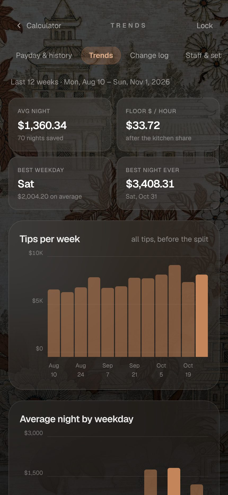

# The Ace · Tip Cash-Out Calculator

A web app for splitting a restaurant shift's tips and paying them out each week. Staff enter the cash and card tips at close, pick who worked front of house, and get each person's payout. The owner gets a payday view, a Thursday email, and pay stubs for the staff. Built for The Ace and used on the host-stand iPad every night.

**Live:** https://acecashout.com · **Case study:** [docs/CASE_STUDY.md](docs/CASE_STUDY.md)


<p>
  
  &nbsp;
  
</p>
<p>
  
  &nbsp;
  
  &nbsp;
  
</p>

## How the split works

1. Cash and card tips are added into one pool.
2. 30% goes to the kitchen (BOH). Managers can change the percentage in Staff & settings.
3. The remaining 70% is the FOH pool, shared by hours worked: `rate = FOH pool / total FOH hours`, and each person gets `hours × rate`.
4. Everything is worked out in whole cents, and any leftover cent goes to whoever's share was closest to rounding up, so the payouts and BOH always add up to exactly the tips collected.

## Features

- Live preview of the total, BOH share and hourly rate in the bottom bar, plus an estimate next to each person's hours as you type.
- Inline validation that points at the missing field instead of a pop-up.
- A results card that flags when inputs changed after calculating.
- Copy to clipboard, share to WhatsApp, or save a formatted PDF report (jsPDF loads only when you first save).
- A "+ Extra" slot for someone who isn't on the regular roster.
- **Payday for the owner**: tips for a Mon–Sun week are paid on the Friday two weeks after it starts. History opens on that payday with who gets what, flags nights with no saved cash-out, and lets the owner mark the week paid, which locks its shifts. Every Thursday morning an email with the totals and a CSV goes out automatically (`vercel.json` cron), and History has a preview of it.
- **Shift history** (needs the backend below): save a cash-out with one tap, correct and re-save it, then browse past shifts by week or month, see each person's totals and average hourly, and export a payroll-ready CSV. Behind a manager PIN.
- **Pay stubs**: when a week is marked paid, everyone on the roster with an email gets their tips for that week, night by night, with a private signed link to view it online.
- **Works offline and installs to the home screen**: a cash-out saved with no signal waits on the iPad and uploads when the connection returns, and a half-entered one survives a reload.
- **Trends**: tips per week, the average night by weekday, floor pay per hour, and the card/cash mix, with a table view.
- **Staff & settings**: edit the roster (with emails for stubs) and the kitchen's percentage without touching code.
- **Change log**: every save, correction, delete, payment and setting change, in plain sentences.
- Mobile first: large tap targets, a sticky action bar, safe-area padding and reduced-motion support.

## Tech

[Next.js](https://nextjs.org) 16 (App Router, Server Actions) · React 19 · TypeScript · Tailwind CSS 4 · Framer Motion · jsPDF · Postgres ([Neon](https://neon.com) via the Vercel Marketplace) with `pg`. Deployed on Vercel from `main`; the old GitHub Pages URL now just forwards to acecashout.com ([`.github/workflows/nextjs.yml`](.github/workflows/nextjs.yml)).

```
app/page.tsx              server entry; turns history on when it's configured
app/Calculator.tsx        calculator UI and state
app/actions.ts            server actions: save a shift, PIN sign-in/out, delete
app/offline.ts            offline save queue and draft (localStorage)
app/history/              manager area: payday, trends, change log, settings, email preview
app/stub/                 a staff member's private pay stub page
app/api/cron/             Thursday payday email (Vercel Cron)
public/sw.js              service worker that keeps the calculator opening offline
lib/cashout.ts            split math (exact cents), formatting, shareable text
lib/history.ts            history queries and date ranges
lib/auth.ts               manager PIN, signed session cookie, lockout
lib/db.ts, lib/schema.ts  Postgres pool and schema (applied automatically)
lib/payroll.ts            pay-period date maths (Friday pays the week from 18 days earlier)
lib/email.ts, lib/stubs.ts  payday email and pay stubs (Resend)
lib/staff.ts, lib/audit.ts  roster and settings; the change log
lib/trends.ts             weekly and weekday aggregates
lib/pdf.ts                PDF report layout
```

### Backend

| Env var | |
| --- | --- |
| `DATABASE_URL` | Postgres connection string. Adding Neon under the Vercel project's **Storage** tab sets it. |
| `MANAGER_PIN` | The PIN for Shift history. Changing it signs everyone out. |
| `SESSION_SECRET` | Optional key for signing sessions and pay stub links. |
| `CRON_SECRET` | Lets Vercel Cron call the Thursday payday email. |
| `RESEND_API_KEY` | [Resend](https://resend.com) key for sending email (acecashout.com verified as a sender). Pay stubs need only this. |
| `PAYROLL_EMAIL` | Who gets the payday email (comma-separate several). |
| `CLOSED_DAYS` | Optional, e.g. `mon`: days that never count as a missing cash-out. |

Without the first two the calculator works exactly as before and the History button stays hidden. The tables are created on first use; `npm run db:migrate` does it by hand.

Anyone using the calculator can save a cash-out (that's the iPad at close); the server recalculates it from the raw inputs instead of trusting the browser's totals. Reading, exporting and deleting history need the PIN, which locks an IP out for 15 minutes after 5 wrong tries.

## Run it locally

```bash
npm install
cp .env.example .env.local   # or: vercel env pull .env.local
npm run dev        # http://localhost:3000
npm test           # split-math and payday tests
npm run lint
npm run typecheck
```

CI ([`.github/workflows/ci.yml`](.github/workflows/ci.yml)) runs lint, typecheck, tests and a production build on every pull request.
