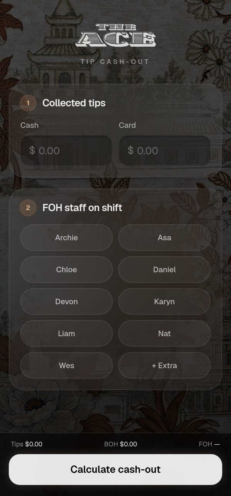
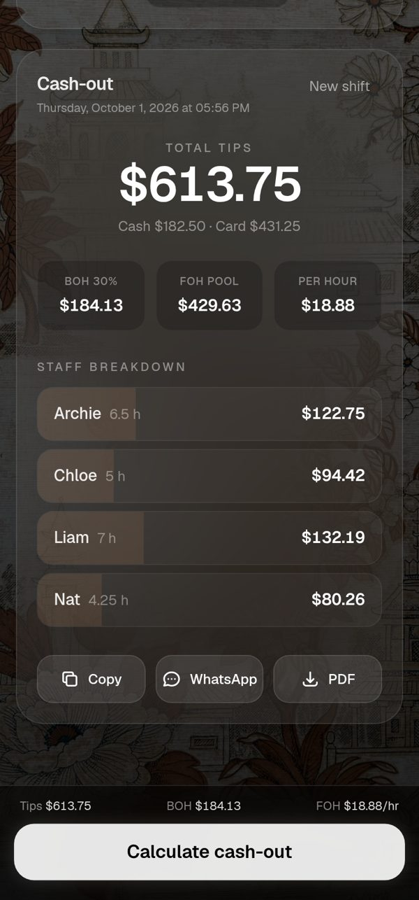

# The Ace · Tip Cash-Out Calculator

A small web app for splitting a restaurant shift's tips. Enter the cash and card tips, pick who worked front of house, add their hours, and get each person's payout. Built for the staff at The Ace and used on a phone at the end of the night.

**Live:** https://acecashout.com

<p>
  
  &nbsp;
  
</p>

## How the split works

1. Cash and card tips are added into one pool.
2. 30% goes to the kitchen (BOH).
3. The remaining 70% is the FOH pool, shared by hours worked: `rate = FOH pool / total FOH hours`, and each person gets `hours × rate`.
4. Everything is worked out in whole cents, and any leftover cent goes to whoever's share was closest to rounding up, so the payouts and BOH always add up to exactly the tips collected.

## Features

- Live preview of the total, BOH share and hourly rate in the bottom bar, plus an estimate next to each person's hours as you type.
- Inline validation that points at the missing field instead of a pop-up.
- A results card that flags when inputs changed after calculating.
- Copy to clipboard, share to WhatsApp, or save a formatted PDF report (jsPDF loads only when you first save).
- A "+ Extra" slot for someone who isn't on the regular roster.
- **Shift history** (needs the backend below): save a cash-out with one tap, correct and re-save it, then browse past shifts by week or month, see each person's totals and average hourly, and export a payroll-ready CSV. Behind a manager PIN.
- Mobile first: large tap targets, a sticky action bar, safe-area padding and reduced-motion support.

## Tech

[Next.js](https://nextjs.org) 16 (App Router, Server Actions) · React 19 · TypeScript · Tailwind CSS 4 · Framer Motion · jsPDF · Postgres ([Neon](https://neon.com) via the Vercel Marketplace) with `pg`. Deployed on Vercel from `main`; the old GitHub Pages URL now just forwards to acecashout.com ([`.github/workflows/nextjs.yml`](.github/workflows/nextjs.yml)).

```
app/page.tsx              server entry; turns history on when it's configured
app/Calculator.tsx        calculator UI and state
app/actions.ts            server actions: save a shift, PIN sign-in/out, delete
app/history/              manager-only history page and CSV export
lib/cashout.ts            split math (exact cents), formatting, shareable text
lib/history.ts            history queries and date ranges
lib/auth.ts               manager PIN, signed session cookie, lockout
lib/db.ts, lib/schema.ts  Postgres pool and schema (applied automatically)
lib/pdf.ts                PDF report layout
```

### Backend

| Env var | |
| --- | --- |
| `DATABASE_URL` | Postgres connection string. Adding Neon under the Vercel project's **Storage** tab sets it. |
| `MANAGER_PIN` | The PIN for Shift history. Changing it signs everyone out. |
| `SESSION_SECRET` | Optional key for signing sessions. |

Without the first two the calculator works exactly as before and the History button stays hidden. The tables are created on first use; `npm run db:migrate` does it by hand.

Anyone using the calculator can save a cash-out (that's the iPad at close); the server recalculates it from the raw inputs instead of trusting the browser's totals. Reading, exporting and deleting history need the PIN, which locks an IP out for 15 minutes after 5 wrong tries.

## Run it locally

```bash
npm install
cp .env.example .env.local   # or: vercel env pull .env.local
npm run dev        # http://localhost:3000
npm test           # split-math tests
npm run lint
```
