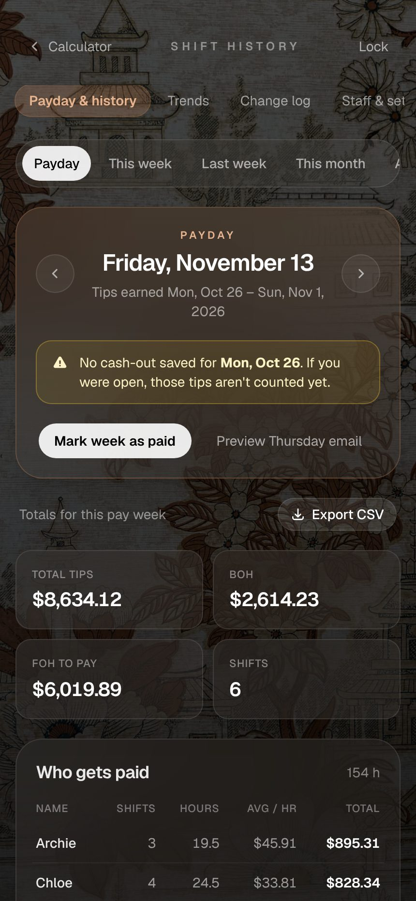
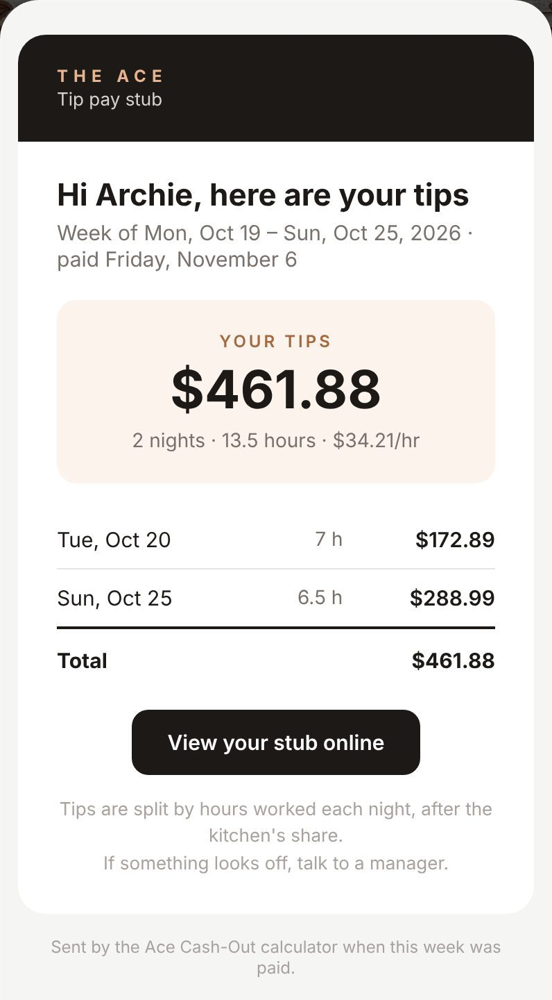

# Case study: from a tip calculator to a payroll tool

**The Ace** is a restaurant where the floor staff split tips at the end of every night. This project started as a one-screen calculator for that split and grew into the system the owner now uses to pay tips each week.

  
  &nbsp;
  
  &nbsp;
  

## The problem

At close, someone adds up the cash and card tips, takes the kitchen's share, and divides the rest by hours worked. Doing that by hand on a phone calculator was slow and easy to get wrong by a few cents.

The bigger cost sat with the owner, Rafa. Every week he paid tips for a Monday–Sunday week that ended almost two weeks earlier. To do it, he opened a Google Drive folder, then the year, then the month, then each night's PDF in turn, and added everything up by hand. That took a long time and depended on every PDF having been saved.

## What I built

**For the closing shift (the iPad at the host stand)**

- Enter the cash and card tips and tap who worked. The split appears live as the hours go in.
- Save the night with one tap. The server recomputes it from the raw numbers, so a tampered or stale browser can't save wrong totals.
- The app installs to the iPad home screen and still works with no signal. A night saved offline waits on the device and uploads as soon as the connection is back. A half-entered cash-out survives a reload.

**For the owner**

- The **Payday** view opens on the right week automatically. Friday pays the week that started 18 days earlier. It shows who gets what, and flags any night with no saved cash-out before he pays.
- Every Thursday morning an email lists the people to pay, with a CSV attached. It comes from a Vercel Cron job.
- **Mark week as paid** locks that week. A correction can no longer change money that has already gone out.
- When he marks a week paid, everyone on the roster with an email gets their own **pay stub**: their tips for that week, night by night, plus a private signed link to view it online.
- **Trends** shows tips per week, the average night by weekday, floor pay per hour, and the card/cash mix.
- **Staff & settings** lets a manager edit the roster and the kitchen's percentage without a code change.
- The **change log** records every save, correction, delete, payment and setting change in plain sentences. Nothing can be edited out of it from the app.

## Decisions worth explaining

**Money in whole cents, and it always adds up.** Each person's share is worked out in cents, using largest-remainder rounding. The leftover cent goes to the share that was closest to rounding up. The payouts plus the kitchen's share therefore equal the tips collected exactly, with no stray penny. Unit tests pin this down.

**Pay periods are plain date strings.** The payday rule depends on calendar days, not instants. All the date maths runs on `YYYY-MM-DD` strings in UTC, and nothing touches a local clock until the display step. This avoids daylight-saving bugs. A shift that closes after midnight belongs to the night before.

**A paid week is locked in the database, not just the UI.** A save or delete runs in a transaction that first takes a share lock on that week's `pay_periods` row. If the week is paid, the transaction refuses the change. A late save can't slip past the lock while the owner is marking the week paid.

**Emails are claimed before they're sent.** The Thursday email and each pay stub first insert a row into `email_log`. If the row already exists, nothing is sent, so a retried cron job or a pay–undo–pay sequence never sends a duplicate. If sending fails, the claim is released so the next try can go through. Marking a week paid sends the stubs with `after()`, so the button responds instantly.

**Offline without a sync engine.** The iPad needed to survive a dead connection at close, not to edit history while offline. So a service worker caches the calculator screen. Unsent saves sit in `localStorage`, keyed by the shift's id. Because the server treats a save as an upsert, sending the same one twice is harmless.

**Small, boring security.**
- A manager PIN gates the history pages, with an HMAC-signed session cookie.
- An IP is locked out for 15 minutes after five wrong tries.
- Pay stub links carry an HMAC token, so changing the name in the URL shows nothing.
- Security headers are set, and secrets live only in environment variables.

## Stack

Next.js 16 (App Router, Server Actions, `after`), React 19, TypeScript, Tailwind CSS 4, Postgres on Neon via `pg`, Vercel (hosting and cron), Resend (email), jsPDF.

Charts are plain HTML and SVG, with no chart library. They use one copper hue, thin columns, hover and focus tooltips, and a table view for accessibility.

## Quality

- `node:test` unit tests cover the split maths and the payday rules.
- GitHub Actions runs lint, the typecheck, the tests and a production build on every pull request.
- Each feature was checked end to end in a real browser against a local Postgres seeded with twelve weeks of nights. The checks covered saving, correcting, offline queueing, locking a week, the stub link (and a tampered one), and every manager page.

## Outcome

Paying tips goes from opening every PDF and adding them up by hand to reading one email and tapping one button, and every number has a trail behind it.
